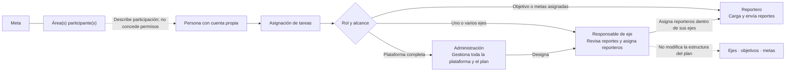
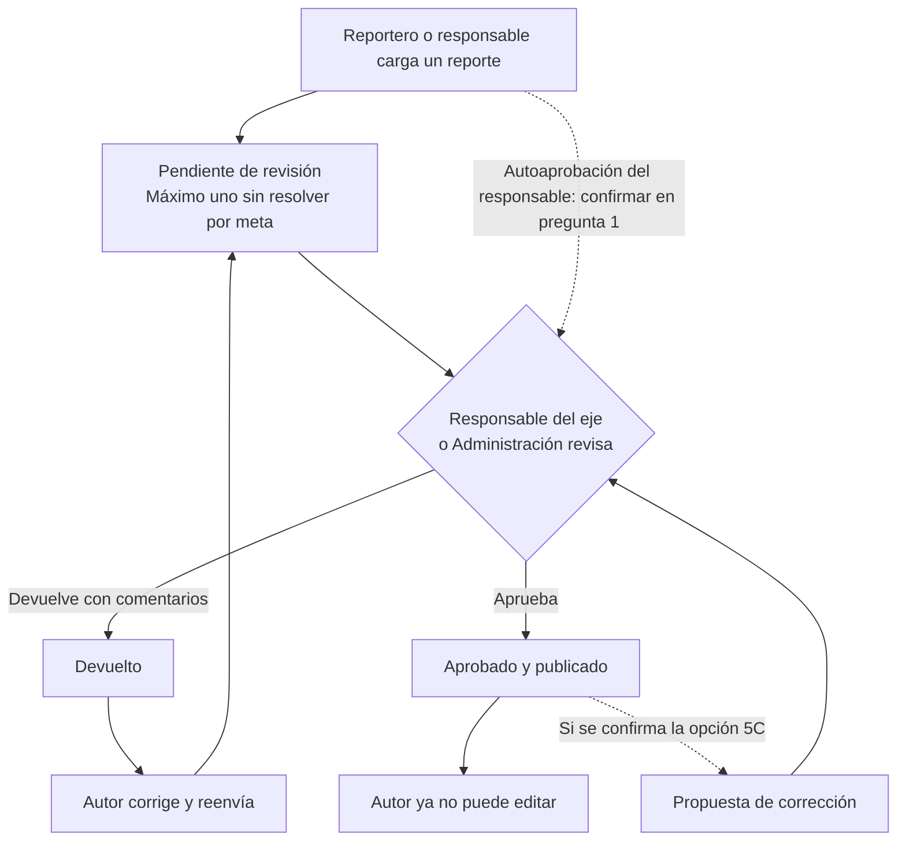
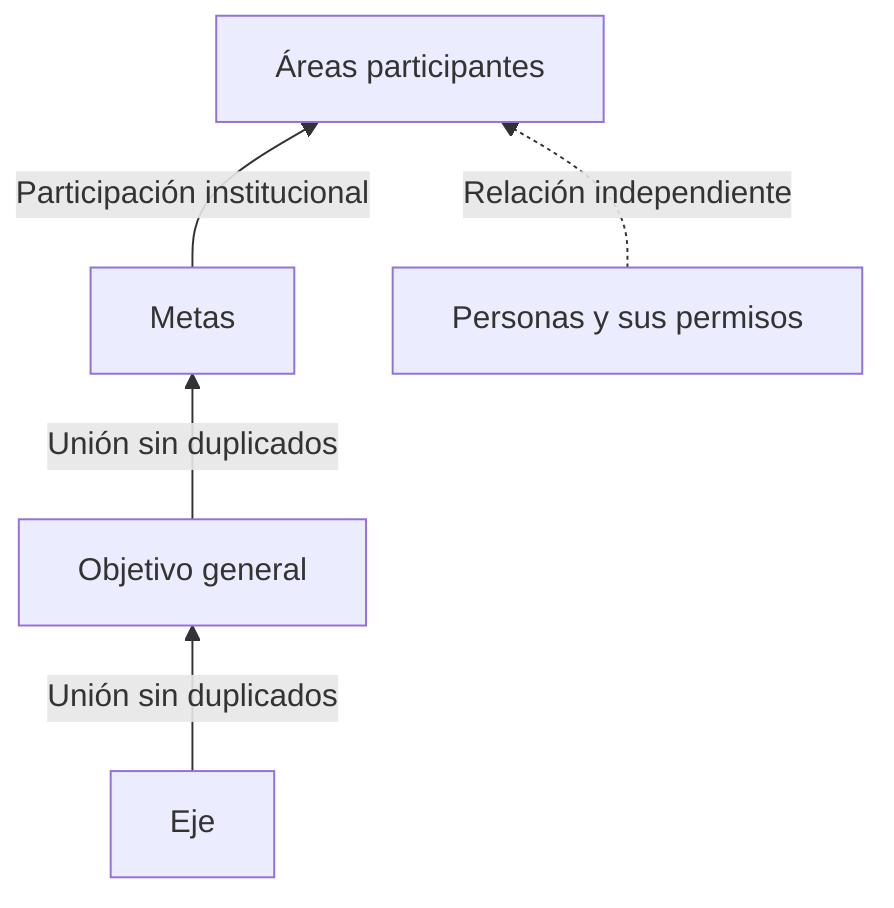

# Organización del equipo: delegación, reportes y publicación

> **Antecedente histórico.** Las respuestas recibidas y las definiciones posteriores del 13 de noviembre de 2026 se consolidan en [Decisiones finales — Versión 2](./decisiones-finales-roles-y-reportes-v2.md). Ese documento prevalece sobre las propuestas y diagramas de este cuestionario, especialmente en el alcance de los Responsables por meta, la separación entre validación y publicación y el límite de pendientes por tipo de reporte.

Borrador posterior a la reunión del 27 de octubre de 2026. Describe el esquema que se propone construir, no las funciones disponibles hoy.

La sección 1 está preparada para copiar en un mail. Las secciones 2 y 3 son notas de trabajo internas y no forman parte del correo.

## 1. Correo para enviar

**Asunto:** Próximos pasos: organización de equipos y revisión de reportes

Hola, equipo:

Gracias por la reunión. Nos ayudó a ordenar una propuesta: partir de las tareas que necesita realizar cada persona e incorporar los permisos necesarios, sin dar acceso de más.

Los permisos se asignarían a **personas**, no a áreas. Dentro de una misma área puede haber personas con distintas responsabilidades. Las áreas servirían para identificar la participación institucional, sin otorgar acceso por sí mismas.

### Punto de partida

**Lo que recogimos de la reunión:**

- **Administración:** mantiene el control de toda la plataforma y del plan, incluyendo usuarios, estructura y reportes.
- **Responsable de eje:** revisa la calidad de los reportes de su eje, los aprueba o devuelve y asigna o desasigna reporteros dentro de ese eje. No crea, modifica ni elimina objetivos estratégicos, objetivos generales ni metas.
- **Reportero:** carga y envía reportes de las metas asignadas. Puede corregir sus propios reportes mientras no estén aprobados; después de aprobados, no puede modificarlos.
- **Autor público:** no se mostrará el nombre y apellido de la persona que informa. Internamente se conservará quién realizó cada acción.

**Propuestas para completar ese esquema:**

- Un eje puede tener varios responsables y una persona puede ser responsable de varios ejes. Cualquiera de los responsables asignados puede resolver una revisión, sin exigir la aprobación de todos.
- Un responsable puede cargar reportes dentro de su eje. La carga no implica aprobación automática.
- Cada meta puede tener **un solo reporte pendiente de aprobación**, para mantener el orden de los avances.
- Administración designa a los responsables de eje y administra el listado de áreas.

Si algo de este punto de partida no representa lo conversado, por favor indíquennos qué cambiarían.

### Preguntas para cerrar la propuesta

Pueden responder con el número y la letra elegida, por ejemplo: **1A, 2C, 3B**. En todas las preguntas pueden agregar **“Otro: …”** o **“A definir”**. Las recomendaciones son sugerencias, no decisiones tomadas.

**1. Si un responsable de eje carga un reporte, ¿puede aprobarlo él mismo?**

- **A.** Sí, mediante una acción de aprobación separada. También puede dejarlo para que lo revise otro responsable. **Recomendación:** permite que el equipo organice su revisión sin imponer una segunda persona.
- **B.** No; siempre debe aprobarlo otro responsable del eje o Administración.
- **C.** Otro: __________.

**2. ¿Cómo necesitan asignar el trabajo de los reporteros?**

- **A.** Por meta: se eligen las metas en las que puede reportar cada persona.
- **B.** Por objetivo general: puede reportar en todas sus metas.
- **C.** De ambas formas, según el caso. **Recomendación:** permite asignaciones específicas y también equipos que trabajan sobre un objetivo completo.
- **D.** Otro: __________.

**3. Si una persona está asignada a un objetivo general y se agrega una meta nueva, ¿qué debería pasar?**

Responder si eligieron 2B o 2C.

- **A.** Puede reportar también en la nueva meta, automáticamente.
- **B.** Un responsable debe asignársela expresamente antes de que pueda reportar.
- **C.** Otro: __________.

**4. Antes de aprobar un reporte, ¿quién puede corregirlo?**

- **A.** Solo quien lo cargó. El responsable lo devuelve con comentarios cuando necesita cambios.
- **B.** Quien lo cargó y los responsables de su eje, dejando registro de quién modificó qué.
- **C.** Otro: __________.

Administración conserva su acceso en cualquiera de las opciones.

**5. Si un reporte ya aprobado tiene un error, ¿cómo se corrige?**

- **A.** Solo Administración puede modificarlo; el equipo le solicita la corrección.
- **B.** También un responsable del eje puede corregirlo directamente, dejando registro del cambio.
- **C.** Un responsable propone una corrección y se revisa antes de reemplazar lo publicado. **Recomendación:** mantiene la revisión y evita depender de Administración para cada ajuste.
- **D.** Otro: __________.

**6. ¿Dónde necesitamos identificar las áreas participantes?**

- **A.** En cada meta. Las áreas de un objetivo y de un eje se obtienen reuniendo las de sus metas, sin repetirlas. **Recomendación:** permite reflejar diferencias entre metas.
- **B.** En el objetivo general; las mismas áreas participan en todas sus metas.
- **C.** En el objetivo general, con posibilidad de indicar áreas diferentes en cada meta.
- **D.** Otro: __________.

En todos los casos, identificar un área participante no asigna permisos a sus integrantes.

**7. En la vista pública de un reporte, en lugar del nombre de la persona, ¿qué mostramos?**

- **A.** Todas las áreas participantes de la meta.
- **B.** Solo el área o las áreas que participaron en ese reporte, seleccionadas al cargarlo entre las participantes de la meta.
- **C.** Ningún nombre de persona ni de área.
- **D.** Otro: __________.

**8. ¿Quién puede vincular o desvincular las áreas participantes de una meta u objetivo?**

- **A.** Solo Administración.
- **B.** Administración y los responsables del eje correspondiente, eligiendo del listado de áreas existente. **Recomendación:** delega la organización del trabajo sin habilitar cambios al resto de la estructura del plan.
- **C.** Otro: __________.

Crear, renombrar o dar de baja áreas del listado general seguiría siendo tarea de Administración.

**9. Para los avisos de trabajo —reportes para revisar, devoluciones y aprobaciones—, ¿qué canal necesitan?**

- **A.** Avisos dentro de la plataforma y por correo electrónico. **Recomendación inicial:** ayuda a enterarse sin tener que ingresar para comprobar si hay novedades.
- **B.** Solo dentro de la plataforma.
- **C.** Solo por correo electrónico.
- **D.** Otro: __________.

### Próximo paso

Con estas respuestas prepararemos el circuito definitivo y confirmaremos qué cambios necesita la plataforma. Después podremos probarlo con un eje y un equipo pequeño.

Si hay alguna tarea importante que no quedó contemplada, pueden agregar un ejemplo: **“Necesitamos que [persona o función] pueda [tarea] sobre [eje, objetivo o meta]”**. No hace falta definir nuevos roles ahora.

¡Gracias!

## 2. Notificaciones esenciales propuestas

Propuesta de eventos y destinatarios, independiente del canal que se elija. No implica que estos avisos ya estén implementados.

| Evento | Destinatarios | Información o acción necesaria |
|---|---|---|
| Designación o retiro como responsable de eje | Persona afectada | Eje, cambio de responsabilidad y acceso al trabajo cuando corresponda. |
| Asignación o retiro como reportero | Persona afectada | Objetivo o metas alcanzadas y quién realizó el cambio. |
| Reporte enviado o reenviado a revisión | Responsables del eje | Meta, período si corresponde, autor interno y enlace para revisar. |
| Reporte devuelto | Autor del reporte | Motivo de la devolución y enlace para corregir y reenviar. |
| Reporte aprobado | Autor del reporte | Confirmación y enlace a la publicación. |
| Revisión resuelta por otro responsable | Otros responsables que recibieron el aviso pendiente | Actualizar el aviso original para mostrar que ya se resolvió; no hace falta otro correo. |
| Corrección de un reporte aprobado | Autor y responsables del eje | Qué cambió, quién lo cambió y motivo. Si se elige revisión de correcciones, avisar primero a quienes deban revisarla. |
| Reporte enviado sin responsables de eje disponibles | Administración | Advertir que necesita intervención e incluir un enlace a la revisión. |

### Criterios para evitar ruido

- Administración no necesita recibir copia de cada revisión: interviene en excepciones y conserva una vista general de pendientes.
- No avisar a todas las personas de un área ni a todos los reporteros de una meta: avisar a quienes deben actuar o conocer el resultado.
- Evitar avisos a quien acaba de realizar la acción y duplicados por tener varias asignaciones. Si no queda otra persona revisora, el pendiente debe seguir visible para quien puede autoaprobar.
- El aviso debe llevar al recurso y reflejar su estado vigente. Una notificación no otorga acceso.
- No incluir información sensible del reporte en el correo; usar el detalle dentro de la plataforma con acceso autorizado.
- Los recordatorios por demora pueden incorporarse después, cuando se acuerden plazos de revisión. No son necesarios para definir el primer circuito.

## 3. Criterios internos de diseño y pendientes

Los siguientes diagramas son apoyos visuales para explicar el modelo y conversar sus decisiones; no agregan acuerdos ni describen funciones ya implementadas. Mermaid se renderiza en visores compatibles. Para incluirlos en un mail o Google Docs, conviene pegar una imagen exportada, no el bloque de código.

### Personas, tareas y alcance

La cuenta identifica a la persona; la asignación define las tareas y su alcance. Las áreas describen participación institucional, no son roles ni grupos de permisos. La forma de asignar reporteros (por objetivo, por meta o ambas) queda sujeta a la respuesta 2.

### Permisos por tarea y alcance

- Diseñar cada permiso como **acción + alcance**: por ejemplo, revisar reportes de un eje o cargar reportes de determinadas metas. No partir de un administrador al que se le quitan opciones.
- Los roles agrupan tareas; no tienen que ser una jerarquía en la que cada rol hereda todo el anterior. Un responsable de eje no necesita editar la estructura del plan para revisar reportes.
- La misma persona puede tener distintos roles y alcances. Ser reportero en otro eje no habilita a revisar sus reportes por ser responsable del primero.
- Separar cuatro relaciones: cuenta personal, asignación de tareas, participación institucional de áreas y autoría interna del reporte.
- Asignar reporteros no equivale a crear cuentas, designar responsables ni conceder administración. Esas tareas no se delegan implícitamente.
- El responsable solo puede asignar reporteros a objetivos o metas de sus propios ejes. La designación de responsables queda en Administración.
- No convertir automáticamente el Responsable actual de objetivo en Responsable de eje: tienen alcances y facultades distintos. La transición requiere revisar las asignaciones existentes.

### Circuito de reportes

- Una carga del responsable sigue el mismo circuito que las demás: no se aprueba automáticamente. La autoaprobación explícita depende de la respuesta 1.
- Con varios responsables, una resolución debe cerrar la revisión para todos. Evitar aprobaciones o devoluciones simultáneas incompatibles.
- La aprobación debe corresponder al contenido efectivamente revisado. Si se permite editar mientras está pendiente, evitar que se publique una versión modificada después de la revisión sin volver a comprobarla.
- Mantener como propuesta un único reporte sin aprobar por meta, incluidos los devueltos hasta su resolución. Precisar si habrá borradores y cuándo ocuparán ese lugar; no asumir que es un bloqueo por período.
- La restricción de un pendiente por meta no determina por sí sola el orden de los períodos informados. Validar por separado si necesitan impedir cargas fuera de orden.
- La revisión de una corrección publicada, si se elige 5C, debe conservar visible la versión aprobada hasta resolver la nueva propuesta y definir quién puede aprobarla.
- Retirar una asignación no debe borrar autoría ni reportes. Definir cómo se reasigna la corrección de un pendiente si su autor ya no tiene acceso.

El diagrama resume el flujo propuesto. La posibilidad de editar reportes aprobados, la autoaprobación y el tratamiento de borradores dependen de las respuestas y definiciones pendientes.

### Áreas y publicación

- Si se elige 6A, obtener las áreas de objetivos y ejes como conjuntos sin duplicados de las áreas de sus metas. No mantener esas listas agregadas manualmente.
- Antes de crear un catálogo nuevo, revisar si las organizaciones existentes representan esas mismas áreas y pueden reutilizarse o adaptarse. No darlo por resuelto por el nombre.
- La asociación de áreas es independiente de los permisos para editar metas. La respuesta 8 puede habilitar una tarea específica sin permitir cambios a indicadores u otros datos del plan.
- Si se elige 7B, definir qué pasa con el área histórica de un reporte cuando deja de participar en la meta. No sustituirla silenciosamente por la lista actual.
- Confirmar qué sucede con las fechas al corregir una publicación. Conservar como antecedente la propuesta anterior: fecha del reporte separada de publicación por aprobación, sin alterar las fechas históricas originales.

La asignación de áreas a cada meta es la opción recomendada en la pregunta 6. La agregación a objetivo y eje solo aplica si se confirma esa opción.

### Antes del piloto

- Confirmar personas responsables, alcance de cada reportero y quién cubre ausencias o revisiones sin responsable disponible.
- Mantener en Administración las tareas no delegadas expresamente, incluida la omisión de períodos. No sumar facultades por analogía con el nombre del rol.
- Separar las respuestas del cuestionario de los compromisos de desarrollo: las opciones que se elijan requieren revisar alcance, transición y pruebas antes de habilitarlas.
