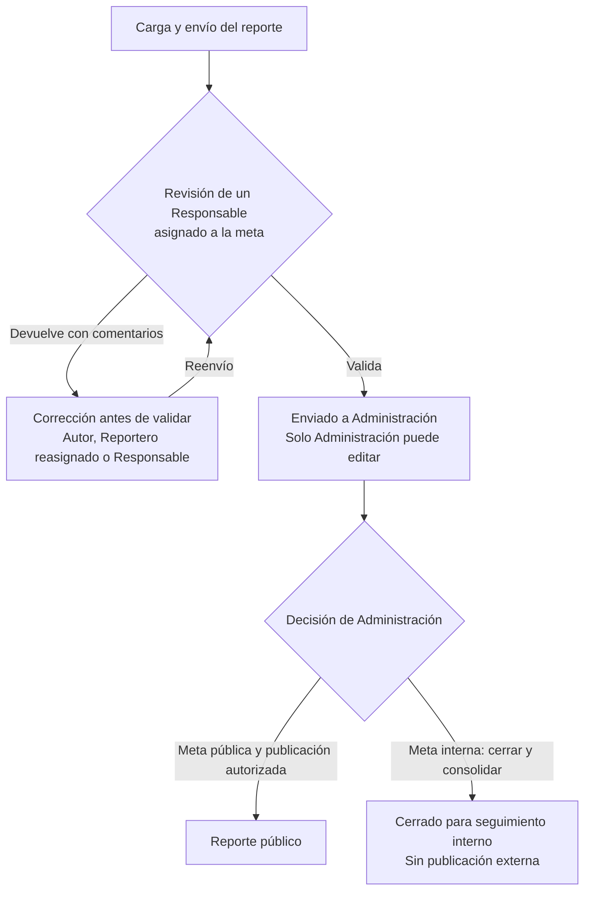

# Decisiones finales: roles, responsabilidades y reportes — Versión 2

**Fecha:** 13 de noviembre de 2026.

**Última actualización:** 18 de noviembre de 2026.

**Estado:** roles y visibilidad definidos; visibilidad fija desde la creación; organizaciones por meta y primera versión de la Mesa de trabajo acordadas; propuestas de diseño y calidad separadas de los pendientes.

**Alcance:** decisiones de producto y requisitos. No describe funciones ya implementadas ni incluye arquitectura, tareas de implementación o un plan técnico.

La sección 1 está preparada para compartir con el Observatorio. Las siguientes conservan el contexto y los pendientes. La sección 8 distingue los requisitos de la Mesa de trabajo de las propuestas de interacción; la sección 9 reúne criterios de calidad, indicando cuáles derivan de decisiones cerradas y cuáles necesitan acuerdo.

## 1. Roles: qué puede y qué no puede hacer cada uno

El rol define **qué tareas puede realizar una persona**; las metas asignadas definen **dónde puede realizarlas**. Se mantienen tres roles: Administración, Responsable y Reportero.

### Administración

**Administra la plataforma, designa a los Responsables y decide qué se publica.**

Puede:

- Administrar usuarios y la estructura del plan: ejes, objetivos estratégicos, objetivos generales y metas.
- Asignar y quitar Responsables de cada meta. Una misma meta puede tener varios Responsables, y una persona puede ser Responsable de varias metas.
- Asignar y quitar Reporteros, además de administrar el conjunto de usuarios que podrán ser seleccionados para esa tarea.
- Intervenir en la revisión y corrección de cualquier reporte.
- Editar los reportes que ya fueron validados por un Responsable, incluso antes de su publicación. En esa etapa es el único rol que puede editarlos.
- Definir, al crear cada meta, si es pública o completamente interna, y autorizar la publicación de reportes de metas públicas. La visibilidad no cambia después de la creación. Un reporte de una meta interna no puede publicarse externamente.
- Validar cualquier modificación de información ya publicada.
- Administrar el catálogo de organizaciones y confirmar sus asociaciones con las metas.

**No tiene restricciones de alcance por meta:** conserva el control completo de la plataforma. La validación realizada por un Responsable no reemplaza su autorización de publicación.

### Responsable

**Organiza la carga y asegura la calidad de la información de sus metas asignadas.**

Puede:

- Asignar y quitar Reporteros en sus metas, dentro del conjunto de usuarios habilitados para ser seleccionados.
- Reasignar la atención de reportes pendientes aún no validados si quien los cargó no puede continuarlos, sin cambiar su autoría histórica.
- Crear y enviar reportes de sus metas.
- Revisar y corregir reportes de sus metas mientras no estén validados, dejando registro de los cambios.
- Validar los reportes o devolverlos con comentarios.
- Validar sus propios reportes mediante una acción explícita y separada de la carga. También puede dejar la revisión a otro Responsable asignado a la misma meta.
- Solicitar correcciones de información ya publicada y trabajar con quien reporta en la preparación de la propuesta, sin modificar directamente lo publicado.
- Sugerir cambios en las organizaciones asociadas; la decisión final es de Administración.

No puede:

- Crear, modificar ni eliminar la estructura del plan.
- Designar o quitar otros Responsables, nombrar Responsables suplentes ni transferir sus responsabilidades a otra persona.
- Crear cuentas ni conceder permisos generales.
- Asignar Reporteros fuera de sus metas o elegir usuarios por fuera del conjunto habilitado.
- Editar un reporte después de que haya sido validado, aunque todavía no esté publicado y aunque sea su autor.
- Publicar reportes, cambiar su visibilidad ni modificar directamente información publicada.
- Gestionar otras metas por el solo hecho de pertenecer al mismo objetivo o eje.

**Si una meta tiene varios Responsables, comparten la función:** cualquiera de ellos puede realizar la revisión, sin exigir la validación de todos. Si hace falta incorporar otro Responsable, lo asigna Administración.

### Reportero

**Carga y mantiene la información que debe ser revisada.**

Puede:

- Crear y enviar reportes de sus metas asignadas.
- Corregir sus propios reportes mientras no hayan sido validados.
- Atender devoluciones del Responsable y reenviar la información corregida.
- Continuar pendientes aún no validados que se le hayan reasignado expresamente, conservando la autoría original.
- Colaborar con el Responsable en una solicitud de corrección de información publicada, sin modificarla directamente.

No puede:

- Validar ni publicar reportes.
- Editar reportes después de su validación, aunque todavía no se hayan publicado.
- Modificar directamente información publicada ni cambiar su visibilidad.
- Editar reportes de otras personas que no se le hayan reasignado expresamente.
- Asignar personas, crear cuentas ni cambiar la estructura del plan.

### Reglas comunes

- Una persona puede ser Responsable de algunas metas y Reportero de otras. Cada función se ejerce únicamente dentro de su alcance.
- Las organizaciones (áreas, organismos, instituciones y otras entidades) identifican participación institucional: no otorgan permisos a las personas.
- Los Reporteros pueden asignarse por meta o por objetivo general. Las metas nuevas siempre requieren asignación expresa.
- Los avisos de trabajo se recibirán dentro de la plataforma y por correo electrónico, vinculados al trabajo asignado.
- **Después de la validación del Responsable, solo Administración puede editar el reporte.** La validación y la publicación son decisiones distintas.
- Una meta completamente interna solo puede consultarse por Administración y por sus Responsables y Reporteros asignados. No aparece, ni contribuye a cifras o indicadores, en la vista pública.
- En las vistas generales de gestión, cada persona ve las metas públicas y las internas que tiene asignadas; Administración ve el conjunto completo. La Mesa de trabajo se concentra en las metas y tareas que le corresponden.
- Las personas integrantes de los equipos PFI tendrán una **Mesa de trabajo** en su panel para acceder a sus metas y pendientes. Administración tendrá accesos y secciones para organizar sus propias tareas.

**Usuarios seleccionables:** deben integrar equipos PFI, ya sean del MISP, entes, empresas u organismos vinculados. Administración gestiona esa pertenencia. Ser seleccionable no concede acceso a ninguna meta interna ni permiso para reportar hasta que se realiza una asignación. Queda por precisar cómo representar la pertenencia y qué sucede al retirarla.

**Registro público:** se conserva. La información pública se consulta sin registrarse; tener una cuenta ciudadana no habilita a integrar equipos ni a consultar información interna.

## 2. Origen y cambios respecto de la versión 1

Antecedentes: devolución **«PFI v0.3.0- Roles, responsabilidades, reportes.pdf»** y [primera consolidación de decisiones](./decisiones-finales-roles-y-reportes.md).

Esta versión incorpora las definiciones de la conversación del 13 de noviembre, la devolución posterior recibida el 16 y las confirmaciones de la reunión y conversación del 18 de noviembre de 2026. La versión 1 conserva la transcripción de las opciones marcadas en el PDF y sus referencias de página; no se atribuyen a ese formulario las decisiones posteriores.

| Tema | Versión 1 / devolución original | Definición de versión 2 |
| --- | --- | --- |
| Alcance del Responsable | Responsable de eje; reparto por metas sin precisar si limitaba permisos. | **Responsable de metas asignadas.** La asignación delimita sus facultades de gestión, no solo sus notificaciones. |
| Varios Responsables | Varios por eje; se pedían suplencias y transferencia de metas. | **Una meta puede tener varios Responsables, designados por Administración**, que comparten la función. No se incorpora una facultad especial de nombrar suplentes o transferir responsabilidades. |
| Asignación de Reporteros | El responsable del eje asignaba reporteros dentro de ese eje. | El Responsable sigue asignando Reporteros, **solo dentro de sus metas y entre integrantes de equipos PFI**. |
| Edición después de validar y antes de publicar | Sin definición. | **Solo Administración puede editar.** El autor y los Responsables de la meta pierden la edición al validarse el reporte. |
| Selección de usuarios | No definida. | El universo son los **equipos PFI**, no solo el Observatorio ni cualquier usuario registrado. Se mantiene la búsqueda propuesta por nombre, apellido o correo; la representación de la pertenencia sigue pendiente. |
| Información interna | Sin definir audiencia ni consecuencias sobre la vista pública. | **Meta completamente interna**, accesible solo por Administración y personas asignadas. Las cifras se calculan sobre el conjunto visible en cada contexto. |
| Registro público | Se discutió la posibilidad de cerrarlo. | **Se conserva**, sin otorgar por ello pertenencia PFI ni acceso interno. |
| Organización del trabajo | No especificada. | **Mesa de trabajo para integrantes PFI y secciones de pendientes para Administración**, incorporadas el 18 de noviembre. |

Se conservan las decisiones del PDF sobre autoaprobación explícita, autorización final de publicación por Administración, correcciones de lo publicado, áreas, canales de notificación y coexistencia de pendientes de distintos tipos. La respuesta 4B sobre edición anterior a la aprobación se concreta ahora como **edición anterior a la validación del Responsable**.

## 3. Asignaciones, responsabilidad compartida y continuidad

### Alcance de gestión

- Administración asigna Responsables a metas concretas. No existe una facultad general sobre todas las metas del eje por tener este rol.
- Si dos personas son Responsables de una meta, ambas pueden cargar, corregir antes de validar y validar los reportes de esa meta. No se requiere unanimidad ni doble validación.
- Ser Responsable de una meta no habilita a designar más Responsables; esa decisión sigue centralizada en Administración.
- Fuera de Administración, la consulta de una meta interna requiere estar asignado a ella como Responsable o Reportero. Pertenecer al equipo PFI, al mismo organismo o al mismo eje no amplía ese acceso.

### Asignación de Reporteros

- Puede realizarla Administración o un Responsable dentro de sus metas.
- La modalidad por objetivo general abarca metas existentes, no futuras. No puede usarse para asignar metas fuera del alcance de quien realiza la operación.
- Buscar una persona por nombre, apellido o correo no autoriza a seleccionarla: la búsqueda debe respetar el conjunto de candidatos permitido.
- La pertenencia a un equipo PFI no es un rol y no reemplaza la asignación específica. No está limitada al Observatorio; incluye los equipos de los organismos que participan en el PFI.

### Cobertura de ausencias

- Otro Responsable ya asignado a la misma meta puede ejercer la función compartida. Si hace falta agregar o reemplazar un Responsable, interviene Administración.
- Los Responsables conservan la asignación ordinaria de Reporteros. Eso no les permite convertir un Reportero en Responsable.
- Se mantiene la posibilidad de reasignar la atención de un pendiente aún no validado al perder acceso su autor, a cargo de un Responsable de esa meta o, en su defecto, Administración.
- Reasignar la atención no cambia la autoría histórica. Asignar un nuevo Reportero a una meta tampoco le permite editar automáticamente todos los reportes de otros usuarios.
- No forman parte de esta base un rol «Suplente», vencimientos automáticos de suplencias ni una operación especial de transferencia masiva de responsabilidades.

## 4. Validación, edición y publicación

### Permiso de edición por etapa

| Situación del reporte | Reportero | Responsable de esa meta | Administración |
| --- | --- | --- | --- |
| Aún no validado, incluidos los devueltos por un Responsable | Puede editar los propios y los pendientes expresamente reasignados. | Puede corregir los de sus metas. | Puede editar. |
| Validado y enviado a Administración, todavía sin resolver | No puede editar. | No puede editar, aunque sea su autor o quien lo validó. | **Único rol que puede editar.** |
| Reporte interno cerrado y consolidado | No puede editar ni eliminar. | No puede editar ni eliminar. | No puede editar ni eliminar. |
| Publicado | No puede modificar directamente lo publicado. | No puede modificar directamente lo publicado. | Toda modificación de lo publicado requiere su validación. |

La restricción posterior a la validación se aplica a **todos** los Responsables de la meta, no solo a quien validó. Mantener un reporte para uso interno no devuelve la edición a los demás roles. El cierre interno es terminal para proteger el resultado consolidado.

El diagrama es conceptual, no una definición de estados técnicos. La visibilidad pertenece a la meta y limita la de sus reportes; no es una etapa de revisión. Administración conserva su intervención general y toda modificación debe dejar trazabilidad. Para una meta interna, Administración cierra explícitamente el reporte validado; desde ese cierre se aplican sus cambios y se consolida para el seguimiento, sin publicación externa.

**Autoaprobación:** un Responsable puede validar lo que cargó, pero la carga no valida automáticamente ni autoriza a publicar.

**Correcciones de contenido publicado:** el Responsable y quien reporta pueden preparar una propuesta. La versión pública no se reemplaza sin validación de Administración, incluso si el cambio es un error de tipeo. El circuito de la propuesta no concede edición directa sobre el reporte validado o publicado.

Administración no devuelve reportes: si necesita corregir uno validado, lo edita directamente. No existe un mecanismo que reabra la edición a Responsables o Reporteros. Un reporte interno cerrado no se puede editar ni eliminar.

## 5. Visibilidad, indicadores y otras decisiones funcionales

### Meta completamente interna — definido el 18 de noviembre

- Administración determina si una meta es pública o completamente interna al crearla, también cuando la crea mediante importación. **La visibilidad no cambia después** (definido el 18 de noviembre, después de la fase 5): una meta interna no pasa a pública ni una pública a interna. Una eventual «representación pública» de metas internas queda fuera del alcance actual.
- Una meta interna no tiene ficha pública, ni siquiera una ficha vacía o un cartel que revele su existencia.
- No se exponen públicamente su descripción, valores previstos, resultados, avances, reportes ni adjuntos. Validar o aprobar un reporte no permite eludir la visibilidad de la meta.
- Solo Administración y los Responsables y Reporteros asignados pueden consultarla. El acceso de lectura no amplía sus permisos de edición.
- Ser integrante de los equipos PFI, cualquiera sea la categoría u organismo, no concede consulta sobre todas las metas internas.
- Que una meta sea pública no hace públicos automáticamente los reportes que todavía están en revisión o pendientes de autorización.
- El registro ciudadano se conserva; la consulta pública no requiere iniciar sesión. Registrarse no da acceso a información interna.

### Contadores e indicadores según el contexto

Ejemplo acordado: **40 metas en total, 20 públicas y 20 internas**.

| Contexto de consulta | Conjunto de metas utilizado |
| --- | --- |
| Portal y dashboards públicos | **20 públicas**, incluso si quien abre esa vista es un administrador. |
| Consulta general de gestión de una persona asignada a 3 metas internas | **23: las 20 públicas y esas 3 internas**, sin datos ni agregados de las otras 17 internas. |
| Dashboard general de Administración | **40**, el conjunto completo. |
| Mesa de trabajo personal | Las metas asignadas a esa persona, públicas o internas. No incorpora todas las públicas solo por ser consultables. |

- Totales, porcentajes, gráficos e indicadores se calculan con el mismo conjunto autorizado y los filtros aplicados. No se ocultan fichas mientras se conserva un denominador o una agregación sobre las 40 metas.
- La misma regla alcanza las agregaciones por objetivo, eje y organización: el ámbito público solo incorpora información pública.
- La visibilidad de una meta no determina por sí sola qué reportes son datos consolidados para los indicadores. Los públicos se consolidan al publicarse; los internos, solo cuando Administración los cierra explícitamente después de validar. Los internos cerrados cuentan en gestión, nunca en agregados públicos.
- Un dashboard personal no representa necesariamente el total del plan. Su alcance debe estar identificado para no presentar un subconjunto como el total general.

### Reportes pendientes de distintos tipos

- Pueden coexistir, en una misma meta y período, un reporte de avance y otro de hito pendientes de validación.
- Se conserva la regla existente: un solo reporte de Avance por período; el Avance reserva ese período aunque esté devuelto o validado, hasta que el reporte se elimine.
- No se añade un cupo global de pendientes. Los Hitos pueden coexistir con el Avance del período.

### Organizaciones y presentación pública

- El concepto se denomina **Organizaciones** y engloba áreas, organismos, instituciones y otras entidades, sin clasificarlas por tipo por ahora (definido el 18 de noviembre). Se reutiliza el catálogo existente de organizaciones.
- Cada meta tiene una **organización responsable** de su reporte y puede tener varias **organizaciones participantes**, independientes de las personas que cargan o validan.
- Las organizaciones de objetivos y ejes se reúnen desde sus metas, sin duplicados ni concesión de permisos. Las asociaciones directas entre objetivos y organizaciones dejan de usarse.
- Administración mantiene el catálogo y confirma las asociaciones. Los Responsables solo pueden sugerir cambios. Una organización dada de baja se desactiva: no se ofrece para nuevas asociaciones y conserva su nombre en el historial.
- En la vista pública de una meta pública y de sus reportes publicados se muestra la organización responsable como información principal y las participantes con menor jerarquía. Las asociaciones de metas internas no se exponen por esta vía.
- Cada reporte publicado conserva las organizaciones que tenía la meta al publicarse. Los reportes publicados antes de existir ese registro no muestran organizaciones.
- No se muestra el nombre y apellido del reportero como identificación pública; la autoría y las acciones se conservan internamente.
- Se mantiene la solicitud de filtrar metas por organizaciones participantes. El componente visual y los detalles del filtro no están definidos.

### Notificaciones

Se mantienen los canales **plataforma y correo**: los avisos de asignación y revisión siempre quedan en la plataforma; el correo respeta la preferencia de cada persona. El alcance se limita a las **metas asignadas**, no a todo un eje. Las publicaciones públicas conservan los avisos existentes a suscriptores cuando se eligieron al publicar. Un reporte interno no genera un aviso para suscriptores ni un enlace público; al cerrar y consolidar, su autor sí recibe un aviso privado.

La siguiente matriz incorpora las precisiones operativas confirmadas para la fase 7:

| Evento | Destinatarios / acción |
| --- | --- |
| Asignación o retiro como Responsable o Reportero | Persona afectada; identifica la meta y el rol. La baja PFI informa los roles retirados por meta. |
| Envío o reenvío a revisión | Responsables asignados a esa meta. Si no tiene Responsables, todos los administradores. |
| Devolución anterior a la validación | Persona que atiende el pendiente o, si no fue reasignado, su autor; incluye el motivo. |
| Validación de una propuesta | Autor y todos los administradores, que reciben el pendiente de resolución. Aún no se publica ni se aplican los cambios. |
| Publicación final de un reporte de meta pública | Autor y Responsables de la meta, con enlace público; se conserva aparte el aviso a suscriptores elegido al publicar. |
| Cierre de un reporte interno | Autor, con enlace de gestión privado; no genera aviso público ni a suscriptores. |
| Revisión resuelta por otro Responsable | Los avisos ya recibidos se conservan como historial; su enlace abre el reporte con el estado vigente. No se envía otro aviso. |
| Solicitud de corrección de información publicada | Administración recibe la solicitud; autor y Responsables correspondientes conocen la resolución. |
| Meta sin Responsable y sin reporte nuevo | No genera un aviso por sí sola. Si se envía o reenvía un reporte que requiere revisión, el aviso va a todos los administradores; las alertas de cobertura de metas sin reportes quedan para la Mesa de la fase 8. |

Los avisos operativos no se envían a quien realiza la acción. Una asignación repetida sin cambio no crea otro aviso; cada transición real sí puede generar el suyo. No hay recordatorios ni resúmenes periódicos. Los avisos ya enviados a suscriptores conservan su funcionamiento actual. Una notificación informa un evento y no reemplaza las tareas que se calculan a partir del estado del reporte. Los enlaces de gestión vuelven a comprobar los permisos al abrirse.

## 6. Evaluación y precisiones necesarias

**Roles y visibilidad tienen una base definida.** Están cerrados el alcance por meta, la edición exclusiva de Administración después de la validación, la meta completamente interna, su audiencia y el alcance de los indicadores. La Mesa de trabajo se incorpora como requisito funcional, sin definir todavía su interfaz ni un plan de implementación.

Quedan estas precisiones que afectan comportamientos concretos y no deben resolverse por suposición:

### 6.1. Gestión de la pertenencia PFI

- ¿Basta con indicar que la persona integra un equipo PFI o se necesitan categorías de pertenencia? Las categorías no concederán permisos por sí mismas.
- ¿Qué ocurre con las asignaciones y pendientes existentes si Administración retira esa pertenencia?

**Cerrado:** el conjunto seleccionable son integrantes de equipos PFI, incluidos los de entes, empresas y organismos, habilitados por Administración. **Pendiente:** representación y tratamiento de la baja, no la apertura de la selección a ciudadanos.

### 6.2. Cierre del seguimiento interno y cambios de visibilidad

- ¿Qué decisión de Administración deja un reporte interno cerrado para el seguimiento y desde qué momento su resultado se considera consolidado?
- Si Administración cambia una meta de interna a pública, ¿qué ocurre con los reportes históricos? El cambio de visibilidad de la meta no debe interpretarse como autorización automática de publicar todo su contenido.
- Si una meta pasa de pública a interna, ¿cómo se comunica el cambio y qué ocurre con sus publicaciones anteriores? El acceso futuro debe respetar la nueva visibilidad, sin prometer recuperar copias ya descargadas.

**Cerrado:** Administración realiza una acción explícita de **Cerrar y consolidar** sobre un reporte interno validado. Desde ese momento sus cambios se aplican y el resultado cuenta para los indicadores de gestión, pero no se publica ni contribuye a agregados públicos. El cierre es terminal: el reporte no se puede editar ni eliminar. La visibilidad de una meta y sus datos sigue limitada a Administración y las personas asignadas.

**Cerrado:** la visibilidad de una meta se fija al crearla y no cambia en ninguna dirección. Las preguntas sobre reportes históricos y comunicación del cambio dejan de aplicar.

### 6.3. Cupo de reportes pendientes

- ¿Qué tipos se distinguen además de avance e hito? ¿Se permiten pendientes del mismo tipo en períodos diferentes?
- ¿El cupo se libera con la validación del Responsable o con una decisión de Administración?
- ¿Cómo cuentan borradores, devueltos, propuestas de corrección y reportes que quedan para uso interno?

**Cerrado:** no se añade cupo global. Se conserva un Avance por período y su reserva persiste mientras exista el reporte, incluso devuelto o validado; eliminarlo libera el período. Un Hito puede coexistir con ese Avance.

## 7. Subpreguntas no bloqueantes para comenzar con la base

No reabren las facultades ya definidas. Deben resolverse antes de habilitar los recorridos adicionales a los que correspondan, sin adoptar respuestas implícitas.

| Tema | Subpreguntas pendientes | Regla que se mantiene |
| --- | --- | --- |
| Devolución desde Administración | ¿Se necesita un circuito formal para pedir una nueva revisión? ¿Cómo se registra y comunica? Si Administración cambia contenido validado, ¿se requiere otra revisión del Responsable? | **Resuelto:** Administración no devuelve; edita directamente. No se reabre la edición a Responsables o Reporteros. |
| Propuestas de corrección de lo publicado | ¿Cómo se presentan, revisan y comunican las propuestas del Responsable y quien reporta? | No alteran la versión pública sin validación de Administración. |
| Organizaciones históricas | ¿Los reportes conservan las organizaciones de su publicación o muestran las actuales? ¿Qué sucede con una organización dada de baja? | **Resuelto:** cada reporte conserva las de su publicación; los anteriores a ese registro no muestran organizaciones. Una organización dada de baja se desactiva y conserva su nombre en el historial. |
| Sugerencias de organizaciones | ¿Se comunican fuera de la plataforma o necesitan un circuito propio? | El Responsable sugiere; Administración decide. |
| Filtro y presentación de organizaciones | ¿Dónde se ofrece el filtro? | Se pidió consultar metas por organizaciones participantes y distinguirlas visualmente de la responsable. |
| Avisos operativos | — | **Resuelto para la fase 7:** todos los administradores reciben reportes validados y, cuando se envía o reenvía un reporte sin Responsable asignado, reciben el aviso para atenderlo. No se avisa por la sola ausencia de Responsable; las alertas de cobertura quedan para la fase 8. No hay recordatorios ni resúmenes; se excluye a quien actuó y se evitan avisos por operaciones sin cambios. Los avisos ya enviados a otros Responsables se conservan como historial. |
| Fechas | ¿Cómo se muestran las fechas de reporte, validación, publicación y corrección? ¿Cómo se tratan los datos históricos? | Validación y publicación siguen siendo hechos distintos. |

## 8. Mesa de trabajo y organización de pendientes

### Requisitos incorporados el 18 de noviembre

- Toda persona integrante de un equipo PFI, independientemente de su categoría u organismo, tendrá una **Mesa de trabajo en su panel de usuario**.
- Desde ella podrá acceder fácilmente a las metas en las que es Responsable, Reportero o ambas cosas, y a las tareas pendientes que le corresponde atender.
- Administración tendrá secciones y atajos para organizar sus decisiones pendientes, sin perder su visión del conjunto del plan.
- La Mesa de trabajo no concede permisos adicionales. Una persona PFI sin asignaciones no accede por eso a otras metas internas.

### Propuestas de diseño para acordar

**Primera versión acordada el 18 de noviembre:** se adoptan Mis metas, Requiere mi acción, Esperando a otra persona, los filtros por rol, objetivo/eje y tipo de tarea, y el orden por antigüedad. Para Administración se adoptan los validados por resolver (separando Publicar y Cerrar), las alertas de continuidad y el acceso a la vista pública. Las solicitudes de corrección de lo publicado se incorporarán cuando se defina ese circuito.

Las demás filas siguen siendo recomendaciones, no decisiones cerradas sobre pantallas o nuevos permisos.

| Propuesta | Comportamiento esperado |
| --- | --- |
| **Mis metas** | Una entrada por meta, mostrando los roles que ejerce la persona, el objetivo y eje, y la indicación de interna cuando corresponda. Si tiene ambos roles, no duplicar la meta ni sus contadores. |
| **Requiere mi acción** | Separar reportes devueltos o pendientes reasignados que debe corregir el Reportero de los reportes por revisar para el Responsable. Ofrecer un acceso directo a la acción permitida. |
| **Esperando a otra persona** | Mostrar por separado reportes enviados o validados que ya no requieren acción propia. No contarlos como tareas que esa persona debe resolver. |
| **Pendientes de Administración** | Reportes validados por resolver, solicitudes de corrección de contenido publicado y necesidades de asignación. Distinguir las metas internas de las públicas, sin llamar «publicar» a la resolución de un reporte interno. |
| **Estado y próximo paso comprensibles** | Indicar qué falta, quién tiene capacidad para actuar y desde cuándo está pendiente. Mantener separados el estado de revisión y la visibilidad de la meta. |
| **Filtros y orden útiles** | Filtrar por rol, objetivo/eje, tipo de tarea y antigüedad. Ordenar por antigüedad permite empezar sin inventar vencimientos; plazos y alertas requieren un acuerdo adicional. |
| **Responsabilidad compartida** | Un mismo reporte puede aparecer a varios Responsables habilitados, pero representa una única revisión. Cuando alguien la resuelve, deja de figurar como pendiente para los demás. |
| **Alertas de continuidad** | Administración identifica metas sin Responsable o pendientes sin una persona que pueda atenderlos. No asignar personas automáticamente ni ampliar permisos para resolverlos. |
| **Vista pública identificable** | Ofrecer a Administración una forma clara de consultar cómo queda el portal público, con sus datos y cifras públicos, sin mezclarlo con la vista completa de gestión. |

**Tareas y notificaciones no son lo mismo:** una notificación avisa de un evento; un pendiente representa trabajo que sigue sin resolverse. Leer o borrar un aviso no completa la tarea, y un correo fallido no debe hacer desaparecer el pendiente.

Una Mesa vacía debe explicar si no hay metas asignadas o si no hay tareas pendientes, sin rellenarse con recursos fuera del alcance. La creación automática de tareas «falta cargar el período» queda como posibilidad a discutir cuando se acuerden obligaciones y fechas de carga.

## 9. Requisitos no funcionales y criterios de calidad

Los requisitos anteriores describen **qué puede hacer el sistema**. Estos criterios describen **cómo debe comportarse**. Los marcados como consecuencia de una decisión cerrada son necesarios para cumplirla; las demás filas son propuestas para acordar, no compromisos de alcance o nivel de servicio.

| Criterio | Estado | Comprobación esperada |
| --- | --- | --- |
| **Confidencialidad en todos los accesos** | Consecuencia de la meta completamente interna. | Una persona que no es Administración ni está asignada a la meta no obtiene contenido ni pistas sobre ella desde enlaces directos, búsquedas, listados, descargas, adjuntos, exportaciones, mapas, avisos o respuestas reutilizadas entre usuarios. Ocultar una tarjeta no es suficiente. |
| **Coherencia de cifras** | Consecuencia del alcance de consulta acordado. | En el ejemplo de 40 metas, las vistas generales muestran 20, 23 o 40 según el contexto definido, y sus indicadores usan ese mismo conjunto. El portal público sigue mostrando 20 aunque se consulte con una cuenta administradora. |
| **Permisos vigentes** | Consecuencia del acceso por asignación. | Al retirarse una asignación, esa persona deja de poder consultar la meta interna o actuar sobre ella, salvo que conserve otra asignación válida o sea Administración. Un enlace o aviso anterior no conserva el acceso; no se borran la autoría ni el historial. |
| **Trazabilidad** | Base conservada; detalle por acordar. | Se puede identificar quién y cuándo cargó, corrigió, validó, publicó, cerró o cambió asignaciones, y quién definió la visibilidad al crear la meta. Registrar los cambios de contenido, incluidos los que hace Administración después de validar, sin exhibir autoría personal en el portal público. |
| **Consistencia ante acciones simultáneas** | Propuesta de confiabilidad. | Dos Responsables no dejan resoluciones contradictorias sobre un mismo reporte. Validar corresponde al contenido efectivamente revisado; una pantalla desactualizada no permite editar después de la validación ni sobrescribir cambios ajenos silenciosamente. |
| **Errores y conservación del trabajo** | Propuesta de confiabilidad. | No mostrar éxito si no se guardó una acción. Explicar el problema y conservar el trabajo ingresado cuando sea posible; un reintento no debe crear reportes ni resoluciones duplicadas. |
| **Avisos confiables y sin ruido** | Propuesta de calidad operativa. | No duplicar avisos por tener varios roles. Las tareas siguen disponibles aunque falle el correo, y sus enlaces respetan los permisos actuales. El contenido enviado no expone detalles internos a personas no autorizadas. |
| **Accesibilidad y adaptación** | Propuesta: tomar WCAG 2.2 AA como objetivo. | Recorridos principales utilizables con teclado, foco visible, etiquetas y errores comprensibles; estado y visibilidad no se distinguen solo por color. Las acciones siguen siendo accesibles en pantallas pequeñas. |
| **Rendimiento de la Mesa de trabajo** | Objetivo numérico por acordar. | Medir el tiempo desde que se solicita la vista hasta que quedan disponibles las metas, tareas y acciones. Como referencia para discutir: hasta 2 segundos en el percentil 95, con volumen de datos, concurrencia y condiciones de medición acordados antes de comprometerlo. |

Estos criterios no eligen tecnologías, componentes ni mecanismos de implementación. Los puntos de la sección 6 siguen requiriendo definición para sus funciones específicas.
