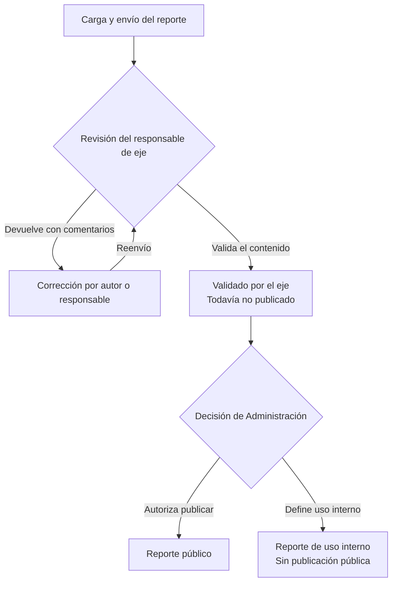

# Decisiones finales: roles, responsabilidades y reportes

> **Versión 1 — antecedente histórico.** La definición actualizada está en [Decisiones finales — Versión 2](./decisiones-finales-roles-y-reportes-v2.md). Incorpora Responsables por meta designados por Administración, responsabilidad compartida y edición exclusiva de Administración después de la validación. Este documento conserva la primera lectura del PDF; sus pendientes y facultades anteriores no prevalecen sobre la versión 2.

**Fecha de consolidación:** 13 de noviembre de 2026.

**Estado:** base funcional definida; precisiones pendientes identificadas.

**Alcance:** decisiones de producto. No contiene un plan de implementación ni describe funciones ya disponibles.

## 1. Fuente y criterio de lectura

Fuente: **«PFI v0.3.0- Roles, responsabilidades, reportes.pdf»**, documento fechado el 28 de octubre de 2026 y recibido para esta revisión el 13 de noviembre. Se revisaron sus seis páginas, incluyendo las opciones resaltadas en amarillo y los agregados y comentarios en verde.

Este documento consolida las respuestas y reemplaza, como definición del comportamiento deseado, las propuestas del [cuestionario de delegación y reportes](./cuestionario-delegacion-y-reportes.md) y del [documento de organización de carga y revisión](./organizacion-carga-y-revision.md). Ambos se conservan como antecedentes.

- **Decisiones confirmadas:** elecciones y agregados explícitos de la devolución.
- **Base conservada:** definiciones del esquema que el PDF mantiene sin objeción. No equivalen a respuestas nuevas resaltadas.
- **Pendientes:** ambigüedades o detalles no respondidos; no se resuelven por suposición.

Los comentarios agregados prevalecen sobre los textos y gráficos anteriores que contradigan. En particular, el diagrama de la página 6 todavía une aprobación y publicación: **ya no representa el circuito acordado**, porque la página 1 agrega una autorización final exclusiva de Administración.

## 2. Respuestas confirmadas

| Pregunta | Respuesta marcada | Decisión | Fuente |
| --- | --- | --- | --- |
| 1. Autoaprobación del responsable | **A** | Puede validar su propio reporte mediante una acción explícita y separada de la carga. No implica permiso para publicarlo. | Pág. 2; agregado de pág. 1. |
| 2. Asignación de reporteros | **C** | Se admiten asignaciones por meta y por objetivo general. | Pág. 2. |
| 3. Metas nuevas de un objetivo asignado | **B** | Requieren asignación expresa; no se incorporan automáticamente al alcance del reportero. | Pág. 2, opción y comentario. |
| 4. Corrección antes de aprobar | **B** | Pueden corregir quien cargó el reporte y los responsables de su eje, con registro de quién modificó qué. Administración conserva su acceso. | Pág. 2. |
| 5. Corrección de reportes aprobados | **D — Otro**, con comentario | El responsable del eje y quien reporta trabajan en conjunto; cualquier modificación de lo publicado requiere validación exclusiva de Administración, incluso errores de tipeo. | Pág. 3. |
| 6. Áreas participantes | **A** | Se definen en cada meta. Las áreas de objetivos y ejes se reúnen desde sus metas, sin duplicados. | Pág. 3. |
| 7. Identificación pública | **D — Otro**, con comentario | Mostrar el área responsable como información principal y las áreas vinculadas con menor jerarquía, tanto en la meta como en el reporte. | Pág. 3. |
| 8. Vinculación de áreas | **A**, con aclaración | Solo Administración puede confirmar vínculos y desvinculaciones. Los responsables de eje pueden sugerirlos, no resolverlos por sí mismos. | Pág. 3. |
| 9. Canal de notificaciones | **A** | Avisos dentro de la plataforma y por correo electrónico. | Pág. 3. |

La respuesta 5 **no es la opción C original**: el comentario reserva a Administración la validación de cambios publicados. La respuesta 7 tampoco elige un subconjunto de áreas por reporte: introduce la distinción entre **área responsable** y **áreas vinculadas de la meta**.

## 3. Roles y alcance de las tareas

### Base conservada

- Se mantienen **tres roles**: Administración, Responsable de eje y Reportero.
- Los permisos se asignan a personas y tienen un alcance. Las áreas representan participación institucional, no conceden acceso a sus integrantes.
- Un eje puede tener varios responsables; una persona puede ser responsable de varios ejes.
- Una revisión no necesita la aprobación de todos los responsables. El alcance individual por meta requiere la precisión indicada en la sección 8.
- Administración designa a los responsables de eje.

### Administración

- Conserva el control completo de la plataforma y del plan: usuarios, estructura y reportes.
- Administra el catálogo de áreas y confirma sus vínculos con las metas.
- Tiene la **autorización final y exclusiva para publicar reportes** y decidir qué metas y reportes son públicos o de uso interno.
- Valida las modificaciones de contenido ya publicado.
- Puede reasignar pendientes cuando no intervenga el responsable del eje.

### Responsable de eje

- Revisa la calidad de la información de su eje; valida reportes o los devuelve.
- Puede cargar reportes y validar los propios de manera explícita. Puede optar por dejar la validación a otro responsable; el sistema no exige una segunda persona para esta instancia.
- Puede corregir reportes antes de su aprobación, dejando trazabilidad.
- Asigna y desasigna reporteros dentro de su eje.
- Puede designar una persona suplente para la carga y transferirle el conjunto de metas de la persona reemplazada dentro de su ámbito.
- Reasigna la atención de un reporte pendiente si su autor ya no tiene acceso; Administración actúa en su defecto.
- **No crea, modifica ni elimina objetivos estratégicos, objetivos generales ni metas.**
- **No publica reportes ni aplica por sí solo cambios a lo ya publicado.**
- Puede sugerir cambios en las áreas vinculadas; la decisión final es de Administración.

La suplencia y la reasignación están expresamente pedidas en las páginas 1 y 5. La expresión «responsable de meta suplente» describe una necesidad de cobertura de la carga: **no se define un cuarto rol** ni se concede automáticamente permiso para crear cuentas o designar otros responsables de eje.

### Reportero

- Carga y envía reportes de las metas asignadas, individualmente o mediante una asignación por objetivo.
- Puede corregir los propios antes de su aprobación. El momento exacto del bloqueo entre validación del eje y publicación necesita la precisión de la sección 8.
- No tiene permiso de validación ni de publicación.
- No modifica directamente un reporte publicado; puede participar con el responsable del eje en la preparación de una corrección sujeta a validación de Administración.

### Asignaciones y reparto entre responsables

**Asignación de reporteros:** se admiten las dos modalidades, pero asignar un objetivo no concede acceso automático a sus futuras metas. Por ejemplo, si el objetivo tiene las metas A, B y C, asignarlo permite trabajar sobre ellas; una meta D agregada después necesita asignación expresa.

**Reparto entre responsables de eje:** se solicita poder atribuir metas concretas a cada responsable, especialmente para evitar notificaciones innecesarias (pág. 1). Está confirmado el reparto de trabajo; **no está definido si también restringe permisos sobre las otras metas del eje**. No debe confundirse una preferencia de avisos con una limitación de acceso.

**Continuidad:** retirar una asignación no borra reportes ni cambia su autoría histórica. Reasignar quién atiende un pendiente no equivale a convertirlo en su autor.

## 4. Validación, publicación y correcciones

### Dos decisiones separadas

1. **Validación del contenido:** el responsable del eje comprueba el reporte y lo valida o devuelve.
2. **Autorización de publicación:** Administración decide si el contenido validado se publica. Un reporte validado por el eje puede mantenerse para uso interno.

Administración conserva su facultad de intervención general. La separación es entre tareas y autorizaciones; no establece por sí sola una obligación de que las realicen personas distintas cuando alguien tiene permisos de Administración.

El diagrama es conceptual, no una definición de estados técnicos. No representa todavía las devoluciones desde Administración ni resuelve los permisos de lectura interna pendientes.

**Autoaprobación:** la respuesta 1A corresponde a la validación del contenido por el responsable. No evita la autorización posterior de Administración ni convierte la carga en una aprobación automática.

### Correcciones posteriores

- El responsable del eje y quien reporta pueden trabajar juntos en el ajuste.
- Ninguna modificación de lo ya publicado queda efectiva sin validación de Administración. No hay una excepción acordada para cambios menores.
- De este requisito se desprende que una propuesta de corrección no debe reemplazar la versión pública antes de su validación.
- No se ha definido el detalle del circuito de esa propuesta ni el tratamiento de cambios después de validar el contenido pero antes de publicarlo.

### Límite de reportes pendientes

La devolución modifica la regla original de «un pendiente por meta»:

- **Distintos tipos de reporte pueden estar pendientes simultáneamente en una misma meta.**
- Debe ser posible tener, por ejemplo, un reporte de avance y otro de hito para el mismo período. El responsable del eje valida ambos.
- La limitación se distingue por tipo de reporte; no debe bloquear a toda la meta por cualquier pendiente.

Fuente: agregado resaltado en página 5. Quedan por precisar los tipos contemplados, si el límite también distingue períodos y cuándo un reporte deja de ocupar ese lugar en el nuevo circuito. No se convierte la mención del «mismo período» en una regla no confirmada de un cupo por período.

## 5. Áreas e identificación pública

### Relaciones institucionales

- Cada meta tiene **un área responsable** de su reporte, independiente de la persona que lo carga.
- Puede tener además varias **áreas vinculadas**.
- Las áreas de objetivos y ejes se obtienen reuniendo las de sus metas, sin repetirlas. Esta agregación no concede permisos a personas.
- Administración mantiene el catálogo y confirma las asociaciones. Una sugerencia del responsable de eje no altera el vínculo hasta esa confirmación.

### Presentación pública

- El área responsable se presenta como información principal.
- Las áreas vinculadas se muestran con menor jerarquía en la ficha de la meta y en la del reporte.
- No se utiliza el nombre y apellido del reportero como identificación pública. La autoría personal y las acciones se conservan internamente.
- El desplegable o carrusel mencionado es un ejemplo de presentación, no una elección de interfaz cerrada.

Se registra además la **solicitud complementaria de filtrar metas por áreas vinculadas**, para consultar todas las metas en las que participa un área (pág. 3). La ubicación del filtro y su detalle de funcionamiento no condicionan la definición de roles.

## 6. Notificaciones

**Confirmado expresamente:** plataforma y correo como canales (9A), necesidad de repartir avisos por metas entre responsables (pág. 1) y aviso de publicación final al autor y responsable del eje con enlace de consulta (fila agregada, pág. 4).

La tabla de notificaciones del PDF sigue titulada «propuestas». Se conserva como base de trabajo, separando las adaptaciones necesarias del nuevo circuito de las confirmaciones explícitas:

| Evento | Destinatarios o acción | Estado de la definición |
| --- | --- | --- |
| Designación o retiro como responsable de eje | Persona afectada. | Propuesta conservada. |
| Asignación, retiro o suplencia de carga | Personas afectadas por el cambio. | Propuesta conservada; suplencia incorporada por el nuevo requerimiento. |
| Envío o reenvío a revisión | Responsables correspondientes a la meta; falta precisar el alcance y las suplencias de ese reparto. | Propuesta ajustada al agregado de pág. 1. |
| Devolución | Autor o persona reasignada para atender el pendiente, con motivo y acceso a la corrección. | Propuesta ajustada a la reasignación de pág. 5. |
| Validación del contenido por el eje | Avisar al autor; poner la decisión de publicación en conocimiento de Administración. | Consecuencia del nuevo circuito; detalle del aviso por acordar. |
| Publicación final autorizada por Administración | Autor y responsable del eje, con enlace público. | **Agregado confirmado en pág. 4.** |
| Revisión resuelta por otro responsable | Actualizar el pendiente para quienes recibieron el aviso. | Propuesta conservada; no necesita implicar otro correo. |
| Corrección de contenido publicado | Administración debe conocer la solicitud; autor y responsables correspondientes, su resolución. | Propuesta ajustada a 5D. |
| Reporte sin responsable disponible | Administración. | Propuesta conservada como excepción. |

**Dos ajustes respecto del texto anterior:**

- El aviso «reporte aprobado» no puede incluir un enlace público como si la validación del eje ya publicara. Debe distinguirse del aviso de publicación final.
- Administración puede evitar copias de cada revisión, pero **ya no interviene solo en excepciones**: tiene una tarea obligatoria de autorización de publicación y de validación de cambios publicados.

## 7. Evaluación: ¿alcanza para empezar a pensar la implementación?

**Sí, alcanza para trabajar posteriormente sobre una base funcional concreta:** están definidos los tres roles, la asignación a personas, la combinación de asignaciones por objetivo y meta, la ausencia de acceso automático a metas futuras, las dos instancias de validación/publicación, la autoridad sobre cambios publicados y áreas, y los canales de comunicación.

**No equivale a tener todos los comportamientos listos para implementar sin consultas.** Hay precisiones que afectan autorizaciones, privacidad y el cierre de un reporte. Se detallan en la sección 8 porque bloquean esos comportamientos específicos, aunque no obligan a reabrir el esquema completo. La sección 9 reúne subpreguntas no bloqueantes para comenzar a pensar la base.

Esta conclusión no fija arquitectura, tareas, plazos ni orden de implementación.

## 8. Precisiones necesarias antes de cerrar los comportamientos afectados

### 8.1. Responsabilidad por meta: ¿organización o autorización?

- ¿El reparto de metas entre responsables de un eje solo dirige el trabajo y las notificaciones, o limita quién puede ver, corregir y validar cada reporte?
- Si limita permisos, ¿otro responsable del mismo eje puede cubrir una ausencia y cómo se autoriza esa cobertura?

**Por qué importa:** conviven el texto «cualquiera de los responsables asignados puede resolver una revisión» y el nuevo reparto por metas. La respuesta define los límites de acceso; no es una preferencia visual.

### 8.2. Entre validación y publicación

- Después de la validación del eje y antes de publicar, ¿pueden seguir editando el autor o los responsables? Si cambian el contenido, ¿debe validarse de nuevo?
- Si Administración requiere cambios, ¿a quién devuelve el reporte y por qué revisión vuelve a pasar?
- Para una corrección de contenido publicado, ¿se exige nuevamente validación del eje antes de la validación final de Administración?

**Por qué importa:** «aprobado» tenía una sola instancia en el cuestionario. Ahora existen dos, y no está precisado dónde cambia cada permiso. Sí está cerrada la prohibición de modificar lo público sin validación de Administración.

### 8.3. Alcance de lo interno y relación entre meta y reporte

- ¿Quién puede consultar metas y reportes internos: solo las personas asignadas, todos los integrantes del eje u otro conjunto?
- ¿Cómo se relacionan la visibilidad de una meta y la de sus reportes? En particular, ¿puede publicarse un reporte de una meta interna?
- ¿Los resultados de reportes internos se incluyen en indicadores o agregados visibles al público?

**Por qué importa:** está decidida la autoridad de Administración para separar lo público de lo interno, pero no la audiencia ni las consecuencias de esa distinción. No puede inferirse que «interno» equivale a «cualquier usuario registrado» ni exponer indirectamente información interna.

### 8.4. Qué ocupa y qué libera el cupo de pendientes

- Además de avance e hito, ¿qué otros tipos cuentan por separado? ¿Se admite más de un pendiente del mismo tipo en períodos distintos?
- ¿El cupo se libera al validar el eje, al resolver Administración o en otro momento?
- ¿Qué ocurre si un reporte queda definitivamente para uso interno? ¿Cómo se consideran devueltos, borradores y propuestas de corrección?

**Por qué importa:** el límite original no contemplaba ni varios tipos ni una instancia posterior de publicación. Está confirmado que avance e hito pueden coexistir, pero no corresponde inventar el resto ni mantener una meta bloqueada indefinidamente por un reporte interno.

## 9. Subpreguntas no bloqueantes para comenzar con la base

No reabren las decisiones anteriores. Algunas deberán responderse antes de habilitar la función correspondiente; «no bloqueante» no significa que se adopte una respuesta por defecto.

| Tema | Subpreguntas pendientes | Qué ya está cerrado |
| --- | --- | --- |
| Suplencias | ¿Son temporales o definitivas? ¿El titular conserva su asignación? ¿Cómo termina la suplencia? ¿El suplente debe tener una cuenta o hay que solicitar su alta a Administración? | El responsable del eje puede designar suplentes y transferir metas dentro de su alcance. No se le concedió expresamente la creación de cuentas. |
| Transferencia de trabajo | ¿La operación permite elegir parte del conjunto además de transferir todas las metas? ¿Cómo se comunica el cambio al titular y al suplente? | Se pidió poder transferir el conjunto de metas y se definió quién reasigna pendientes. No se cambia la autoría histórica. |
| Áreas históricas | Si cambia el área responsable o una vinculada, ¿los reportes anteriores muestran las áreas de ese momento o las actuales? ¿Qué ocurre al dar de baja un área con historial? | Se distinguen área responsable y vinculadas; Administración decide sus asociaciones. |
| Sugerencias de áreas | ¿Se comunican fuera de la plataforma o necesitan un circuito propio dentro de ella? | El responsable puede sugerir; solo Administración confirma. |
| Filtro y presentación de áreas | ¿Dónde se ofrece el filtro? ¿Incluye también al área responsable? ¿Cómo se muestran las áreas vinculadas con menor jerarquía? | Se pidió el filtro por áreas vinculadas y se definió la jerarquía de la identificación pública. |
| Avisos operativos | ¿Qué administradores reciben la tarea de publicación? ¿Hay recordatorios o resúmenes? ¿Cómo se evitan avisos duplicados o a quien acaba de actuar? | Plataforma y correo, aviso de publicación y necesidad de reducir notificaciones ajenas a las metas atendidas. |
| Fechas | ¿Cómo se presentan la fecha del reporte, la validación del eje, la publicación y las correcciones? | Validación y publicación son hechos distintos; la devolución no cerró su presentación ni el tratamiento histórico. |

Las precisiones de permisos, audiencia interna y cupos de la sección 8 **no se trasladan a esta lista como detalles menores**. Ningún pendiente autoriza a ampliar permisos por suposición.
