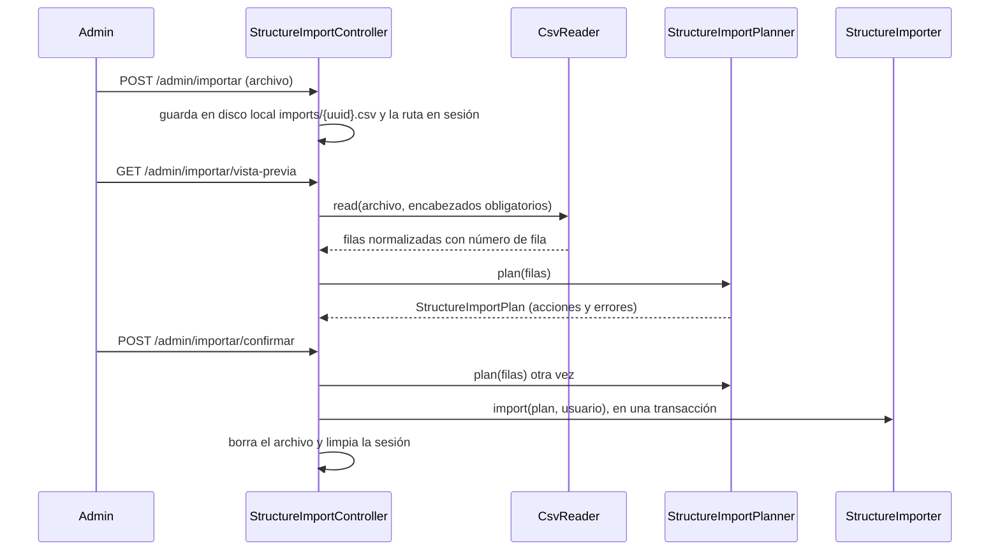

# Manual del importador de estructura (CSV)

El importador permite cargar o actualizar desde una planilla **objetivos estratégicos, objetivos generales y metas**, en lugar de crearlos uno por uno desde los formularios. Está en **Administración › Carga masiva › Importar estructura** (`/admin/importar`) y solo lo pueden usar administradores.

En el sitio, el nivel que reúne metas se llama **Objetivo general**. La planilla conserva sus encabezados de importación: **Objetivo**, **Código objetivo** y **Descripción del objetivo** se refieren a ese nivel. Los valores previstos por período se llaman **Meta** y los datos informados, **Resultado**; no renombres las columnas técnicas de la planilla por ese cambio de vocabulario.

La primera parte está pensada para quien arma la planilla. La última sección resume cómo está implementado.

## 1. Qué hace y qué no

| Hace | No hace |
| --- | --- |
| Crea objetivos estratégicos, objetivos y metas nuevos. | No crea ejes: tienen que existir en **Administración › Ejes**. |
| Actualiza los que ya existen (nombres, descripción y configuración de metas). | No borra nada. Lo que no esté en el archivo queda como está. |
| Configura el indicador de cada meta y genera sus períodos. | No importa hitos, organizaciones ni etiquetas. |
| Muestra una vista previa antes de guardar. | No envía notificaciones a los suscriptores. |

Los cambios se aplican **todos juntos o ninguno**: si el archivo tiene un solo error, no se guarda nada.

## 2. Paso a paso

1. Entrá a **Importar estructura** y descargá una planilla:
   - **Planilla precargada** (`AAAAMMDD-estructura.csv`): todo lo que ya existe en la plataforma, con sus códigos. Es la opción recomendada para editar o agregar metas a objetivos existentes.
   - **Planilla de ejemplo** (`ejemplo-importacion-estructura.csv`): metas inventadas de cada tipo de medición, marcadas con "EJEMPLO -". Sirve para ver cómo se completa cada caso.
2. Abrila en Excel, LibreOffice o Google Sheets y completala: **una fila por meta**.
3. Guardala como CSV (ver [sección 9](#9-cómo-guardar-el-archivo)).
4. Subila con **Validar y ver vista previa**. El archivo puede pesar hasta 5 MB.
5. Revisá la vista previa. Si hay errores, corregilos en la planilla y volvé a subirla.
6. Cuando no haya errores, tocá **Confirmar importación**.

Hasta el paso 6 **no se guarda nada**. Al confirmar, el sistema vuelve a validar todo contra los datos actuales, por si alguien cambió algo mientras revisabas.

### Archivo de demostración

[database/seeders/demo-importacion-estructura.csv](../database/seeders/demo-importacion-estructura.csv) sirve para probar el importador sobre una instalación limpia (`php artisan migrate:fresh --seed`). Agrega 15 metas a objetivos de los datos base, de los tres tipos de medición y con celdas vacías como las que deja una combinación vertical. También crea un objetivo estratégico nuevo en *Aprendizaje y Crecimiento* y tres objetivos nuevos. La vista previa tiene que mostrar 1 objetivo estratégico, 3 objetivos y 15 metas para crear, sin errores.

## 3. Cómo se arma la planilla

### La estructura de cada fila

Cada fila describe una meta y dónde está ubicada:

```text
Eje -> Objetivo estratégico -> Objetivo general -> Meta
```

- **Fila con meta:** crea o actualiza el objetivo estratégico, el objetivo y la meta.
- **Fila sin meta** (columna *Meta* y siguientes vacías): solo crea o actualiza el objetivo estratégico y el objetivo. Sirve para cargar objetivos que todavía no tienen metas.

### Encabezados

- La fila de encabezados tiene que estar dentro de las **primeras 10 filas** e incluir al menos **Eje**, **Objetivo estratégico**, **Objetivo** y **Meta**.
- Arriba de los encabezados podés dejar títulos o filas de agrupación (por ejemplo, "Metas por período" combinada sobre varias columnas): se ignoran.
- El **orden de las columnas no importa** y no se distinguen mayúsculas ni acentos en los encabezados.
- Las columnas que no uses pueden no estar. Las columnas que no reconoce se ignoran.
- Las filas completamente vacías se ignoran.

### Celdas combinadas

Cuando Excel guarda como CSV una celda combinada verticalmente, deja el valor solo en la primera fila y las demás vacías. El importador lo resuelve así: en las columnas de estructura, **una celda vacía toma el valor de la fila de arriba**.

Se puede combinar verticalmente en estas columnas, agrupadas por nivel:

| Nivel | Columnas |
| --- | --- |
| 1 | Eje |
| 2 | Código OE, Objetivo estratégico |
| 3 | Código objetivo, Objetivo, Descripción del objetivo |

Un nivel se hereda **solo si los niveles superiores también están vacíos** en esa fila. Así, cuando aparece un objetivo estratégico nuevo, no se arrastra el objetivo del anterior.

Ejemplo, tal como queda el CSV después de combinar celdas:

| Fila | Eje | Objetivo estratégico | Objetivo | Descripción del objetivo | Meta |
| --- | --- | --- | --- | --- | --- |
| 2 | Transparencia | Fortalecer la transparencia | Publicar datos abiertos | Descripción A | Datasets publicados |
| 3 | | | | | Plazo de respuesta |
| 4 | | | Simplificar procesos | Descripción B | Manual aprobado |
| 5 | | Capacitar al personal | Formación continua | Descripción C | Personas capacitadas |

- La fila 3 hereda todo de la fila 2: es otra meta de *Publicar datos abiertos*.
- La fila 4 hereda eje y objetivo estratégico, y empieza un objetivo nuevo.
- La fila 5 hereda solo el eje. Como cambia el objetivo estratégico, **no** hereda *Simplificar procesos*.

**No combines celdas horizontalmente** en las filas de datos ni en las columnas de la meta. Excel dejaría el valor solo en la primera columna y el resto quedarían vacías.

## 4. Columnas

| Columna | Obligatoria | Valores | Detalle |
| --- | --- | --- | --- |
| **Eje** | Sí | Nombre o número de un eje existente | Los ejes no se crean desde la planilla. |
| **Código OE** | No | Ej: `OE12` | Vacío: se busca el objetivo estratégico por nombre dentro del eje; si no existe, se crea con el próximo código libre. |
| **Objetivo estratégico** | Sí | Texto (hasta 550 caracteres) | Con código, cambiar el nombre lo actualiza. Sin código, un nombre distinto crea uno nuevo. |
| **Código objetivo** | No | Ej: `OG45` | Vacío: se busca el objetivo por nombre dentro del objetivo estratégico; si no existe, se crea con el próximo código libre. |
| **Objetivo** | Sí | Texto (hasta 550 caracteres) | Los objetivos nuevos se crean **ocultos**. |
| **Descripción del objetivo** | Para objetivos nuevos | Texto (hasta 2000 caracteres) | En objetivos existentes, dejala vacía para no modificarla. |
| **ID meta** | No | Número | Viene completo en la planilla precargada. Vacío: se busca la meta por nombre dentro del objetivo; si no existe, se crea. |
| **Meta** | Para cargar una meta | Texto (hasta 550 caracteres) | |
| **Estado** | Sí, si hay meta | En progreso · No cumplida · Inactiva · Alcanzada | "Alcanzada" solo se puede usar en metas existentes, igual que en el formulario. |
| **Fuente** | No | Texto | Fuente de los datos del indicador. |
| **Tipo de medición** | Sí, si hay meta | Sin indicador numérico · Valor acumulado · Por períodos | Define qué otras columnas hay que completar ([sección 5](#5-qué-completar-según-el-tipo-de-medición)). |
| **Indicador** | Si hay indicador | Texto | Qué se mide. Ej: *Días promedio de emisión*. |
| **Unidad** | Si hay indicador | Texto | Ej: días, personas, %, expedientes. |
| **Valor a alcanzar** | Valor acumulado | Número mayor a 0 | Valor final de la meta. |
| **Valor actual** | No | Número | Valor acumulado actual. Vacío: 0 en metas nuevas, sin cambios en las existentes. |
| **Frecuencia** | No | Texto | Solo valor acumulado. Ej: *Mensual*. |
| **Fórmula** | No | Texto | Solo por períodos. Cómo se calcula el indicador. |
| **Dirección** | Por períodos | Mayor es mejor · Menor es mejor · Acercarse a la meta | Qué resultado indica un mejor desempeño. |
| **Naturaleza** | Por períodos | Suma · Promedio | *Suma* para cantidades o avance; *Promedio* para plazos, tasas o porcentajes. |
| **Semántica** | No | Incremental · Nivel acumulado | Vacío: *Incremental*. |
| **Periodicidad** | Por períodos | Mensual · Bimestral · Trimestral · Cuatrimestral · Semestral · Anual | Duración de cada período. |
| **Año de inicio** | Por períodos | Ej: `2027` | Año en que empieza el primer período. |
| **Mes de inicio** | Por períodos | `1` a `12` o nombre del mes | Mes en que empieza el primer período. |
| **Cantidad de períodos** | Por períodos | `1` a `60` | |
| **Meta P1, Meta P2, …** | Por períodos (al menos una) | Número | Valor de meta de cada período. Vacía si ese período no tiene meta. Se pueden agregar columnas hasta *Meta P60*. |

Para qué sirven *Dirección*, *Naturaleza* y *Semántica*, y cómo se calcula el cumplimiento, está explicado en [guia-configuracion-metas-indicadores.md](guia-configuracion-metas-indicadores.md).

### Valores con opciones fijas

No importan las mayúsculas, los acentos ni la puntuación: *por periodos*, *Por Períodos* y *POR PERIODOS* valen lo mismo. Además de la etiqueta principal se aceptan estas variantes:

| Columna | Etiqueta principal | También se acepta |
| --- | --- | --- |
| Estado | En progreso | En curso |
| | No cumplida | Demorada |
| | Inactiva | |
| | Alcanzada | Cumplida |
| Tipo de medición | Sin indicador numérico | Sin indicador |
| | Valor acumulado | Acumulado |
| | Por períodos | Periódico, Períodos |
| Dirección | Mayor es mejor | Un valor mayor es mejor, Mayor |
| | Menor es mejor | Un valor menor es mejor, Menor |
| | Acercarse a la meta | Lo mejor es acercarse a la meta, Acercarse, Acercarse al objetivo, Lo mejor es acercarse al objetivo |
| Naturaleza | Suma | Se suman, Los períodos se suman (cantidades, avance) |
| | Promedio | Se promedian, Los períodos se promedian (plazos, tasas, porcentajes) |
| Semántica | Incremental | La meta de cada período es lo que se agrega en ese período; también se conserva «El objetivo de cada período es lo que se agrega en ese período» |
| | Nivel acumulado | Nivel, La meta de cada período es el nivel a alcanzar al cierre; también se conserva «El objetivo de cada período es el nivel a alcanzar al cierre» |
| Mes de inicio | Enero … Diciembre | `1` a `12`, abreviaturas de tres letras (*ene*, *feb*, …) |

### Números

- Se acepta coma o punto decimal: `12,5` y `12.5` valen lo mismo.
- Si tiene los dos, el último es el decimal: `1.234,5` y `1,234.5` son 1234,5.
- **No uses separador de miles solo**: `1.234` se lee como 1,234 (uno coma dos tres cuatro).
- Un `%` al final se ignora: `80%` se lee como 80.

## 5. Qué completar según el tipo de medición

| Columna | Sin indicador numérico | Valor acumulado | Por períodos |
| --- | --- | --- | --- |
| Meta, Estado, Tipo de medición | Obligatorias | Obligatorias | Obligatorias |
| Fuente | Opcional | Opcional | Opcional |
| Indicador, Unidad | — | Obligatorias | Obligatorias |
| Valor a alcanzar | — | Obligatoria | — |
| Valor actual, Frecuencia | — | Opcionales | — |
| Fórmula | — | — | Opcional |
| Dirección, Naturaleza, Periodicidad | — | — | Obligatorias |
| Semántica | — | — | Opcional |
| Año y mes de inicio, Cantidad de períodos | — | — | Obligatorias |
| Meta P1 … Meta Pn | — | — | Al menos una |

Las columnas marcadas con "—" se ignoran para ese tipo de medición.

## 6. Cómo reconoce lo que ya existe

Para cada nivel, el importador decide si la fila corresponde a algo existente o a algo nuevo:

| Nivel | Primero busca por | Si esa columna está vacía, busca por | Si no lo encuentra |
| --- | --- | --- | --- |
| Eje | — | Nombre o número del eje | Error |
| Objetivo estratégico | Código OE | Nombre, dentro del eje | Lo crea (con el código indicado o el próximo libre) |
| Objetivo | Código objetivo | Nombre, dentro del objetivo estratégico | Lo crea, si tiene descripción |
| Meta | ID meta | Nombre, dentro del objetivo | La crea |

- La búsqueda por nombre no distingue mayúsculas ni acentos.
- Si hay **dos o más con el mismo nombre** en el mismo lugar, la fila da error y pide completar el código o el ID. Pasa en los datos base: hay objetivos con el mismo título dentro del mismo objetivo estratégico.
- Un código que pertenece a otro eje o a otro objetivo estratégico da error: el importador no mueve elementos de lugar.
- Un código de algo eliminado da error.
- Si un mismo código aparece en el archivo con dos nombres distintos, o la misma meta aparece dos veces, da error.

### Qué pasa con las celdas vacías al actualizar

La fila representa **cómo tiene que quedar** la meta. Al actualizar una meta existente:

- Una celda vacía **borra** ese dato. Por ejemplo, *Fuente* vacía deja la meta sin fuente.
- Excepciones: *Valor actual* vacío y *Descripción del objetivo* vacía **mantienen** el valor que ya tenían.

Por eso conviene partir de la **planilla precargada**: trae todos los valores actuales. Si se sube sin tocar, la vista previa muestra todo como "Sin cambios".

### Metas que ya tienen avances

Si una meta ya tiene reportes de avance, se aplican las mismas reglas que en la pantalla de edición:

- **Se puede cambiar:** nombre, estado, fuente, indicador, unidad, fórmula y los valores de *Meta P1…Pn*.
- **No se puede cambiar:** tipo de medición, dirección, naturaleza, semántica, periodicidad, año y mes de inicio ni cantidad de períodos. Si la fila los modifica, da error.

## 7. La vista previa

La vista previa tiene tres partes:

1. **Resumen:** cuántos objetivos estratégicos, objetivos y metas se van a **Crear**, **Actualizar** o quedan **Sin cambios**.
2. **Errores:** cada uno con su número de fila (el mismo que muestra Excel), la columna y qué corregir.
3. **Detalle:** el árbol objetivo estratégico › objetivo › meta, con la acción de cada uno y los cambios como *antes → después*. Los objetivos estratégicos y objetivos nuevos muestran el código que van a recibir.

El botón **Confirmar importación** solo aparece si no hay errores y hay algo para crear o actualizar.

Al confirmar se vuelve a la pantalla de importación con un resumen de lo creado y actualizado. Cada cambio queda registrado en la **Bitácora de acciones** con la aclaración "mediante importación".

## 8. Errores frecuentes

| Mensaje | Qué hacer |
| --- | --- |
| No encontramos la fila de encabezados… | Revisá que las columnas *Eje*, *Objetivo estratégico*, *Objetivo* y *Meta* estén escritas así y dentro de las primeras 10 filas. |
| No existe el eje «…» | Corregí el nombre o usá el número del eje. Si es un eje nuevo, crealo antes en **Administración › Ejes**. |
| Los objetivos nuevos necesitan una descripción. | Completá *Descripción del objetivo*. Si el objetivo ya existía, revisá que el nombre o el código coincidan. |
| Hay N … con este nombre: completá el código / ID. | Usá la planilla precargada o copiá el código o ID desde ahí. |
| «…» no es un valor válido. Opciones: … | Usá uno de los valores listados en la [sección 4](#4-columnas). |
| "Alcanzada" solo se puede usar en metas existentes. | Creá la meta con otro estado y marcala como alcanzada después. |
| La meta tiene N períodos: dejá vacía esta columna… | Hay valores en *Meta P* más allá de la *Cantidad de períodos*: borralos o aumentá la cantidad. |
| Definí el valor de meta de al menos un período. | Completá al menos una columna *Meta P*. |
| La meta ya tiene avances cargados: no se puede cambiar… | Dejá ese dato como estaba (está en la planilla precargada). |
| La meta ya aparece en la fila N. | Hay dos filas para la misma meta: dejá una. |
| El código … pertenece a otro eje / a otro objetivo estratégico. | Corregí el código o dejalo vacío para crear uno nuevo. |
| Completá el año y el mes de inicio. | En metas por períodos van las dos columnas. |

## 9. Cómo guardar el archivo

- **Excel:** *Archivo › Guardar como › CSV UTF-8 (delimitado por comas)*. También se acepta el formato "CSV (delimitado por comas)" común y archivos separados por punto y coma, como los que guarda Excel con configuración en español.
- **LibreOffice Calc:** *Archivo › Guardar como › Texto CSV*, con codificación Unicode (UTF-8).
- **Google Sheets:** *Archivo › Descargar › Valores separados por comas (.csv)*.

Al abrir las planillas descargadas:

- Si Excel muestra todo en una sola columna, usá *Datos › Desde texto/CSV* y elegí coma como separador.
- Algunos nombres que empiezan con `=`, `+`, `-` o `@` aparecen precedidos de un apóstrofo (`'`). Es una protección para que la planilla no los ejecute como fórmulas. Se puede dejar: el importador lo quita al subir el archivo.

## 10. Preguntas frecuentes

**¿Puedo subir el mismo archivo dos veces?**
Sí. Lo que ya se importó se reconoce por código, ID o nombre y aparece como "Sin cambios": no se duplica.

**¿Se borra lo que saqué de la planilla?**
No. Para eliminar algo, hacelo desde la pantalla correspondiente.

**¿Los objetivos importados quedan visibles?**
Los nuevos se crean ocultos. Publicalos desde la configuración de cada objetivo cuando estén listos. Los existentes mantienen su visibilidad.

**¿Quién queda como autor de los objetivos nuevos?**
El administrador que confirmó la importación.

**¿Se avisa a los suscriptores?**
No. La importación no envía notificaciones.

**¿Puedo importar hitos?**
Todavía no. Se cargan desde la pantalla de cada meta.

## 11. Para desarrolladores

### Flujo



### Archivos

| Archivo | Responsabilidad |
| --- | --- |
| `app/Services/Csv/CsvReader.php` | Lector genérico: quita el BOM, convierte Windows-1252 y UTF-16 a UTF-8, detecta el separador (`,` `;` tabulación), ubica la fila de encabezados, normaliza encabezados y revierte el escape de fórmulas de nuestras descargas. |
| `app/Imports/Structure/StructureImportColumns.php` | Única fuente de verdad: encabezados, niveles de jerarquía, valores aceptados y alias, parseo de números y meses, y la ayuda que muestra la pantalla. |
| `app/Imports/Structure/StructureImportPlanner.php` | Rellena hacia abajo, resuelve contra la base, valida con las reglas de los formularios (`GoalIndicatorConfigurator::rules()`) y calcula acciones y cambios. No guarda nada. |
| `app/Imports/Structure/StructureImportPlan.php`, `PlannedItem.php`, `ImportAction.php` | Resultado de la planificación: árbol de ítems, errores y resumen. |
| `app/Imports/Structure/StructureImporter.php` | Aplica el plan en una transacción, usa `GoalIndicatorConfigurator::apply()` para las metas y registra cada cambio en el canal de log `mysql`. |
| `app/Exports/StructureImportTemplateExport.php` | Planilla precargada con el estado actual, en el formato del importador. |
| `app/Exports/StructureImportExampleExport.php` | Planilla de ejemplo. |
| `app/Http/Controllers/StructureImportController.php` | Rutas `admin.import.*`, protegidas por `auth` y `check_role:admin`. |
| `resources/views/admin/import/` | Pantalla principal, vista previa y detalle de cambios. |

### Decisiones

- **Sin cola:** se esperan cientos de filas. Si crece a miles, conviene mover la confirmación a un Job.
- **El archivo no se guarda en el plan:** al confirmar se vuelve a leer y a planificar, para validar contra el estado actual de la base.
- **Aislamiento:** la ruta del archivo vive solo en la sesión del admin que lo subió, en el disco privado `local`.
- **Agregar una columna:** declararla en `StructureImportColumns` (constante, `headings()` y `documentation()`), leerla en el planner y escribirla en `StructureImportTemplateExport` para que la planilla precargada subida sin cambios siga dando "Sin cambios".

### Tests

- `tests/Feature/CsvReaderTest.php`: codificaciones, separadores, fila de encabezados y escape de fórmulas.
- `tests/Feature/StructureImportTest.php`:
  - flujo completo;
  - CSV guardado por Excel en español;
  - errores por fila y columna;
  - metas con avances;
  - nombres ambiguos;
  - que la planilla precargada subida sin cambios no cambie nada;
  - que la planilla de ejemplo sea válida.

```bash
php artisan test --compact --filter='CsvReaderTest|StructureImportTest'
```
